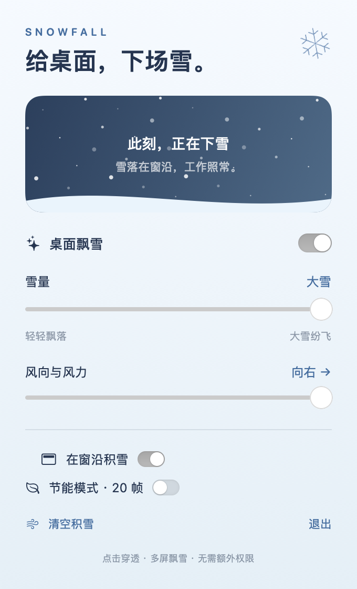

# ❄️ Snowfall for Mac · 桌面飘雪

Let it snow on your Mac. A native menu bar app with drifting snowflakes, snow that settles on window edges, and a mouse-transparent overlay.

[中文说明](README.zh-CN.md) · [Download for Apple Silicon](https://github.com/ponyfly6/snowfall-mac/releases/latest) · [Inspiration](https://x.com/bearliu/status/2121042391217938639)



## Features

- Snowfall across the desktop, with adjustable density and wind.
- Snow accumulates along exposed window edges and follows their positions; overlapping windows mask covered edges.
- Click-through overlays keep your desktop usable.
- Separate overlays for multiple displays and support for desktop Spaces.
- 30 fps target, with a 20 fps energy-saving option. Pauses on sleep and inactive user sessions.
- Local settings, no third-party dependencies, no network requests.
- Reads window geometry without capturing screen contents or reading window titles. No Screen Recording or Accessibility permission prompt.

The interface is currently in Chinese. Click the snowflake in the menu bar for controls; right-click it for pause, clear, and quit.

## Install

Requires **macOS 13 or later**. The downloadable v1.0.0 build is for **Apple Silicon**.

1. Download `Snowfall-macOS.zip` from [Releases](https://github.com/ponyfly6/snowfall-mac/releases/latest).
2. Unzip it and move `Snowfall.app` to Applications.
3. Open the app and click the ❄️ icon in the menu bar.

The app is ad-hoc signed, not Apple-notarized. macOS may block the downloaded build. If you trust this project, use the normal **System Settings → Privacy & Security → Open Anyway** flow, or build from source.

## Build from source

Requires Xcode or a compatible Swift toolchain and the macOS SDK. No extra packages are needed.

```sh
git clone https://github.com/ponyfly6/snowfall-mac.git
cd snowfall-mac
swift test
./scripts/build-app.sh
open dist/Snowfall.app
```

The build script produces an app and ZIP for the host architecture, then signs the app locally. Intel builds are not yet tested.

To regenerate the procedural app icon:

```sh
mkdir -p artifacts
xcrun swift scripts/make-icon.swift artifacts/AppIcon.iconset
iconutil -c icns artifacts/AppIcon.iconset -o Resources/AppIcon.icns
./scripts/build-app.sh
```

## Implementation and limits

AppKit manages the transparent windows and menu bar item, SpriteKit renders the snow, and SwiftUI provides the controls. `SnowfallCore` contains window coordinate conversion, edge occlusion, and snow accumulation logic. Six tests cover geometry, overlap, accumulation bounds, and clearing.

The first build was checked on a Mac with two displays. Full-screen apps and Stage Manager can affect overlay visibility; all combinations, display hot-plugging, and sleep/wake behavior still need broader device testing. This is an early release; issues and contributions are welcome.

## Credits and license

Inspired by the Windows desktop snow demo [shared by Bear Liu](https://x.com/bearliu/status/2121042391217938639). This repository is an independent native macOS implementation; it does not include code or media from that demo.

Released under the [MIT License](LICENSE).
