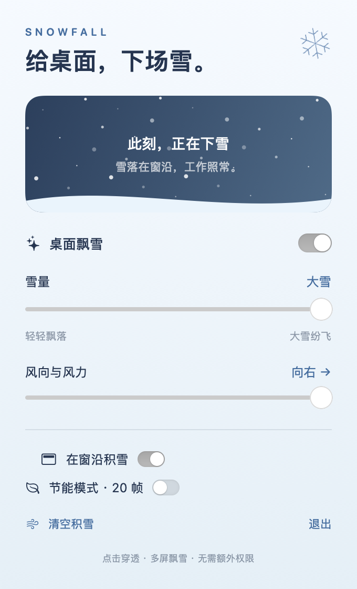

# ❄️ Snowfall · 桌面飘雪

给 Mac 桌面下一场雪。原生菜单栏小工具，雪花随风飘落，在可见窗沿积雪，鼠标可以穿透雪层。

[English](README.md) · [下载 Apple Silicon 版](https://github.com/ponyfly6/snowfall-mac/releases/latest) · [灵感来源](https://x.com/bearliu/status/2121042391217938639)



## 功能

- 调节雪量、风向与风力，随时暂停或继续。
- 在窗口顶边积雪，跟随窗口位置更新，并处理前后窗口遮挡。
- 鼠标点击穿透，不影响原来的窗口操作。
- 每块显示器独立绘制，支持桌面空间。
- 默认目标 30 帧，节能模式 20 帧；睡眠或用户会话切换时暂停。
- 偏好设置保存在本机，无第三方依赖，无网络请求。
- 仅读取窗口几何信息，不截屏、不读取窗口标题，不请求录屏或辅助功能权限。

点击菜单栏的 **❄️ 雪花图标** 打开控制面板。右键图标可以快速暂停、清空积雪或退出。

## 安装

要求 **macOS 13 或更新版本**。v1.0.0 安装包适用于 **Apple Silicon Mac**。

1. 到 [Releases](https://github.com/ponyfly6/snowfall-mac/releases/latest) 下载 `Snowfall-macOS.zip`。
2. 解压，将 `Snowfall.app` 拖进「应用程序」。
3. 打开程序，通过菜单栏雪花图标调节。

安装包采用本机 ad-hoc 签名，尚未经过 Apple 公证。macOS 可能拦截下载的版本。如果你信任本项目，可以使用系统正常提供的「系统设置 → 隐私与安全性 → 仍要打开」流程，或自行从源码构建。

## 从源码构建

需要 Xcode 或兼容的 Swift 工具链及 macOS SDK，无需安装额外依赖。

```sh
git clone https://github.com/ponyfly6/snowfall-mac.git
cd snowfall-mac
swift test
./scripts/build-app.sh
open dist/Snowfall.app
```

构建脚本会生成当前机器架构的 `.app` 和 ZIP，并进行本机签名。Intel 构建尚未测试。

## 验证与已知限制

已通过 6 项核心测试，覆盖坐标换算、窗口遮挡、积雪上限、清空和极窄边缘；已在一台连接两块显示器的 Mac 上检查运行与渲染。

全屏应用和 Stage Manager 的窗口管理可能影响雪层可见性；各种组合、显示器热插拔和睡眠唤醒仍需更广泛的设备测试。欢迎反馈问题和提交改进。

AppKit 负责透明覆盖窗口和菜单栏，SpriteKit 绘制雪花，SwiftUI 提供控制面板；`SnowfallCore` 实现可见窗沿计算和积雪模拟。

## 致谢与许可证

灵感来自 [Bear Liu 分享的 Windows 桌面下雪演示](https://x.com/bearliu/status/2121042391217938639)。本项目为独立实现的原生 macOS 版本，没有使用该演示的源码或媒体素材。

采用 [MIT 许可证](LICENSE) 开源。
